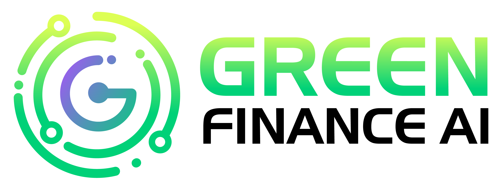

[Green Finance AI](https://greenfinanceai.com) provides data science, machine learning, agentic AI, and full-stack development services. We turn complex data into decisions, and we build the software that puts those decisions to work inside your operations.

Our work covers the whole pipeline, from data engineering and model development to deploying applications and AI agents on virtual machines and cloud platforms. We are trained in scientific programming and used to working between technical detail and strategy, so the people making decisions can trust what the analysis says.

## Services
### 📈 Economics & Statistics Consulting

### 🧠 AI & Machine Learning

### 🕸️ Agentic AI & Integration

### 🛠️ Full-Stack Development

## Live Training Platform
Access our live, containerized training environment designed specifically for data scientists, researchers, and analysts interested in learning how to run LLM tools locally and as part of their analytical pipeline.

With our powerful multi-user JupyterHub setup, every participant receives their own isolated environment and a secure, web-based access to JupyterLab and RStudio Server.

### 🧪 Launch the platform
https://training.greenfinanceai.com

### 📬 Contact for pricing
info@greenfinanceai.com

## Working on the site

The homepage is a single file, `index.php`, styled by `dark-creative/css/style.css` (theme) and `dark-creative/css/custom.css` (our overrides).

### Homepage sections, top to bottom
- Hero: wordmark and tagline.
- About (`#about`): two paragraphs and four service tiles.
- Agentic Workflows and Integration (`#agentic`): intro, a five-step diagram of a multi-agent system, and three short properties (Audited, Reproducible, Governed). All of its styles are scoped to `#agentic` at the end of `custom.css`.
- Frontier AI Model Evaluation (`#ai-evaluation`).
- Pricing (`#pricing`) and Contact (`#contact`).

### Typography
- Handel Gothic: large headings only.
- Gotham Medium: small headings.
- Gotham Narrow: the line under a small heading, and pills.

### Preview locally
From the repository root:

```
php -S localhost:8080
```

Then open http://localhost:8080/?noanalytics (the flag keeps your own visits out of Google Analytics). `analytics.php` and `config.php` are not in the repository; the page needs `analytics.php` beside `index.php` to load.

### Things to know before editing
- Pushing a change to `dark-creative/css/custom.css` on `main` copies that file to the Training Platform repository (`.github/workflows/sync-css.yml`). Keep new rules scoped to a section id so they do nothing there.
- The image shown when the site link is shared (LinkedIn, Slack, messages) is `dark-creative/img/Green-Finance-AI-link-preview.png`, set by the `og:` tags in the `<head>` of `index.php`.
